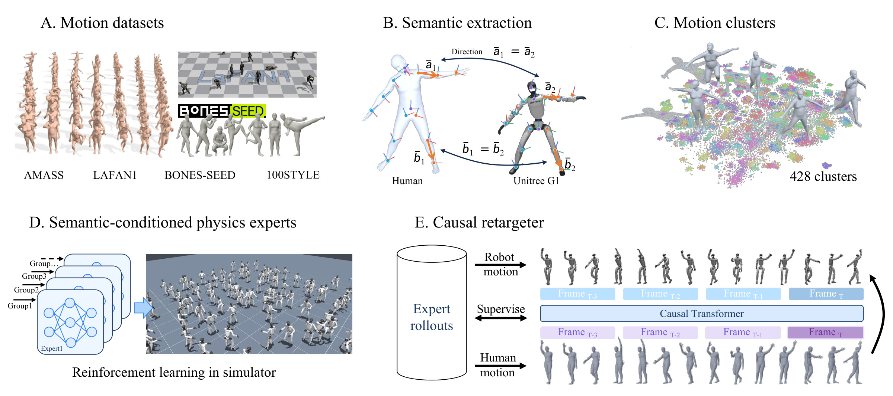

<h1 align="center">SMR: Learning Streaming Motion Retargeting for Humanoids from Human Semantic</h1>

<p align="center"><strong>arXiv preprint</strong> · <a href="docs/paper.pdf"><strong>Paper</strong></a></p>

<p align="center">
  
</p>

SMR learns streaming humanoid motion retargeting from semantic-conditioned physics experts. Human motion is translated into robot-aware task-space targets; accepted expert state rollouts then train a strictly causal Transformer. At inference, SMR uses current and past human observations to generate motion references for a downstream whole-body controller.

## Highlights

- **Robot-aware semantics:** Body landmark positions, orientations, and velocities express the human motion task in the target robot's task space.
- **Physics-grounded supervision:** Experts execute those targets in simulation under contact, dynamics, and actuator constraints. Only accepted state rollouts supervise the student.
- **Streaming inference:** The student uses no future human frames and produces robot motion references, not control actions.
- **Closed-loop evaluation:** On 400 motions with the same frozen G1 controller, SMR completes 97.0% of motions, versus 90.0% for GMR and 92.0% for NMR.

## Results

| Reference source | Completion ↑ | MPJPE ↓ | E-MPJPE ↓ |
| --- | ---: | ---: | ---: |
| GMR | 90.0% | 0.060 m | 0.115 m |
| NMR | 92.0% | 0.057 m | 0.111 m |
| **SMR** | **97.0%** | **0.039 m** | **0.080 m** |

These results use the same 400 test motions and frozen MimicLite whole-body controller in simulation. The paper also presents qualitative streaming teleoperation on a physical Unitree G1.

## Citation

```bibtex
@article{gu2026smr,
  title   = {SMR: Learning Streaming Motion Retargeting for Humanoids from Human Semantic},
  author  = {Gu, Chun and Zhang, Juntong and Li, Jingyu and Zhang, Li},
  journal = {arXiv preprint},
  year    = {2026}
}
```
